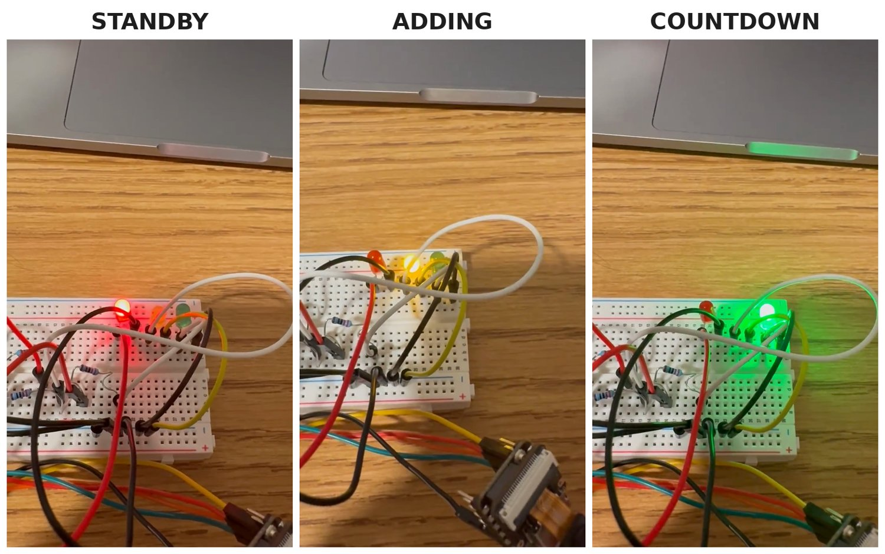

# ESP32 Voice-Controlled Timer

A countdown timer on a Seeed XIAO ESP32-S3 Sense, built in two stages: first controlled by covering a light sensor, then by spoken commands recognized on the board itself.

https://github.com/user-attachments/assets/a7bdf088-a06f-4376-9ed7-a8e3b965b493

| Part | What it adds |
|---|---|
| [**Light-controlled gesture timer**](a1-light-timer/) | Self-calibrating light sensing, tap/hold gesture detection, and a non-blocking four-state timer |
| [**Voice commands**](a2-voice-commands/) | On-device keyword spotting feeding a C++ armed/latched command policy (0.90 accept threshold at 97% precision), driving the same timer |

**Hardware:** Seeed XIAO ESP32-S3 Sense (onboard microphone), GL5528 photoresistor, LEDs, breadboard
**Tools:** C++ (Arduino framework), Arduino IDE, Python / Google Colab

**Results and Limitations:**
Command policy behaves correctly given the model's confidence scores and it made the intended decision in every test including debounce and latch cases. Overall reliability was limited by the speech-recognition model itself and not from my code: 1 of the STOP attempts was classified as GO and 6 of 10 non-command attempts triggered a false command. Tests were designed for a quiet room, but mine were recorded with more background noise than intended which likely increased false triggers. Retraining the model with more background and noise samples can improve results and raising confidence threshold can also reduce false triggers but at the cost of more missed commands. 

**Next Step**: Rerunning same tests in a quiet room as intended and find how much the false-trigger rate came from background noise. Then retraining the model with more background noise samples and rerun the same tests to compare the false-trigger rates.

Built for ECE 116 at UC San Diego.
