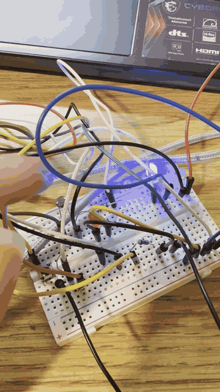

# ESP32 Voice-Controlled Timer

A countdown timer on a Seeed XIAO ESP32-S3 Sense, built in two stages: first controlled by covering a light sensor, then by spoken commands recognized on the board itself.

| Part | What it adds |
|---|---|
| [**Light-controlled gesture timer**](a1-light-timer/) | Self-calibrating light sensing, tap/hold gesture detection, and a non-blocking four-state timer |
| **Voice commands** *(coming soon)* | On-device keyword spotting feeding a C++ command state machine that drives the same timer |

**Hardware:** Seeed XIAO ESP32-S3 Sense, GL5528 photoresistor, LEDs, breadboard
**Tools:** C++ (Arduino framework), Arduino IDE

Built for ECE 116 at UC San Diego.
