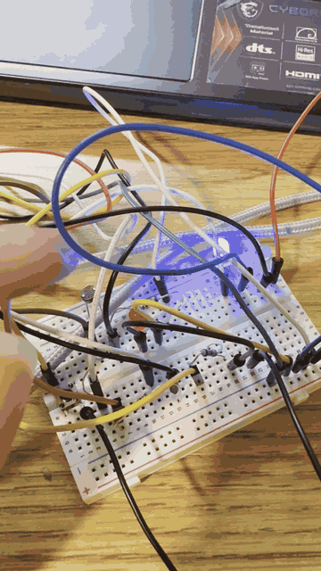
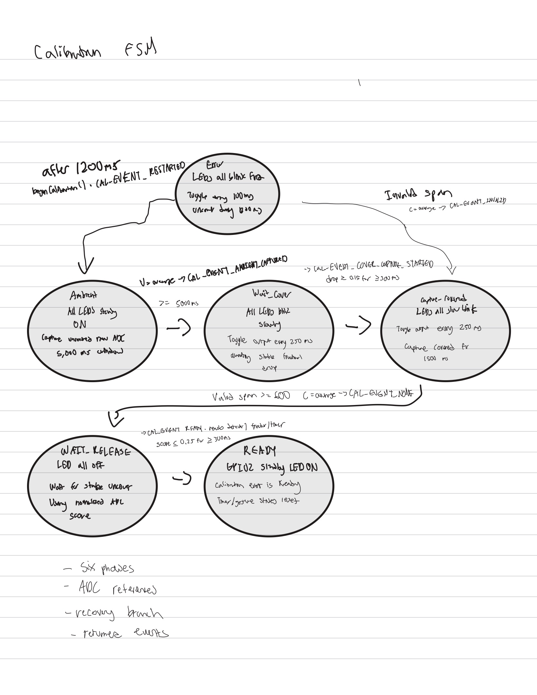
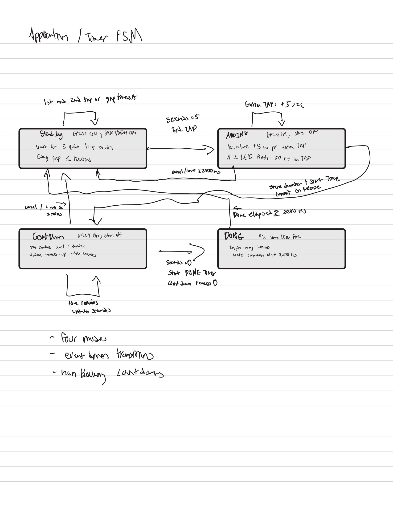
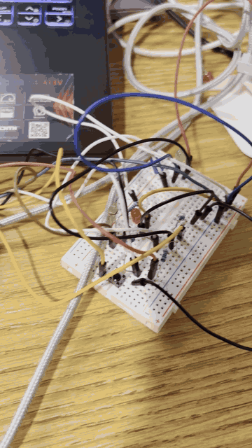
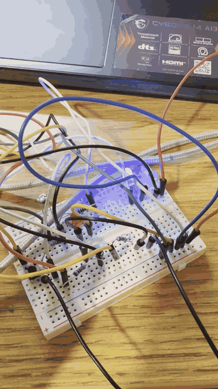
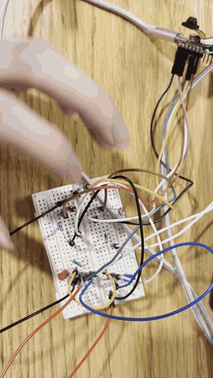

# Light-Controlled Gesture Timer

A countdown timer on a Seeed XIAO ESP32-S3 Sense that you control by covering a light sensor with your hand. Taps add time, a medium hold starts the countdown, and a long hold cancels. It calibrates itself to the room's lighting at every startup, so it doesn't rely on a fixed brightness threshold.

## What it does

1. **Calibrates to the room.** It averages the uncovered light level for 5 s, waits for the sensor to be covered, averages the covered level for 1.5 s, then waits for a stable release. If the covered and uncovered readings are fewer than 600 ADC counts apart, it flags an error and recalibrates.
2. **Turns each reading into a 0-to-1 cover score** across the calibrated range, so the same firmware works in dim and bright rooms.
3. **Detects cover gestures** using hysteresis (enter at ≥ 0.70, release at ≤ 0.30) and a 30 ms stability filter, so flicker and noise don't register as gestures.
4. **Classifies each gesture by how long it's held:**

   | Gesture | Duration |
   |---|---|
   | Tap | 40–499 ms |
   | (dead band) | 500–799 ms, ignored to keep taps and commits distinct |
   | Commit | 800–2499 ms, classified on release |
   | Cancel | ≥ 2500 ms, fires once while still covered |

5. **Runs a four-state timer:** STANDBY → ADDING (three quick taps, each gap ≤ 1200 ms) → COUNTDOWN (commit) → DONE (2 s alert) → STANDBY. A cancel from ADDING or COUNTDOWN returns to STANDBY, and each extra tap in ADDING adds 5 s.

Everything is non-blocking: timing uses rollover-safe `millis()` arithmetic instead of `delay()`, so the sensor keeps being read while the timer runs.

## State machines

| Calibration FSM (6 phases) | Timer FSM (4 modes) |
|---|---|
|  |  |

## Adapting to lighting

The same firmware, reset between two lighting conditions:

| | Normal room | Bright desk |
|---|---|---|
| Uncovered reference | 2645 | 3350 |
| Covered reference | 780 | 830 |
| Span | 1865 | 2520 |
| Cover-enter level (raw ADC) | 1339.5 | 1586.0 |
| Release level (raw ADC) | 2085.5 | 2594.0 |

Both spans clear the 600-count minimum, and because thresholds are set relative to each calibration, a tap is detected the same way in both rooms.

*(sped up 3×)*

## Hardware

- Seeed Studio XIAO ESP32-S3 Sense
- GL5528 photoresistor (LDR) with a 10 kΩ resistor as a voltage divider: 3V3 → LDR → A0 → 10 kΩ → GND
- Three LEDs, one per timer state: blue on D1 (STANDBY), green on D2 (ADDING), red on D3 (COUNTDOWN), each through 220 Ω to GND
- Pushbutton on D4 to GND (used in the warm-up lab)

**Resistor sizing**, with R = (Vsupply − Vf) / Itarget at 3.3 V and a 5 mA target:

- Red (Vf ≈ 2.0 V): 260 Ω
- Green (Vf ≈ 2.1 V): 240 Ω
- Blue (Vf ≈ 3.0 V): 220 Ω gives about 1.4 mA, lower but still clearly visible

220 Ω was used for all three.

## Warm-up: night-light controller

Before the timer, I built a three-mode controller (OFF / AUTO / ON) cycled by a debounced pushbutton. In AUTO, the LED's PWM brightness rises as the room gets darker, mapped linearly from measured bright (2645) and dark (780) readings and clamped at both ends. The building blocks (non-blocking scheduling, debouncing, map-and-clamp, and an enum/switch state machine) carried straight into the timer.

## Tools

C++ (Arduino framework), Arduino IDE, esp32 board package by Espressif (`esp32:esp32:XIAO_ESP32S3`).

## Notes

Built for ECE 116 at UC San Diego. The course supplied the sketch files, interfaces, and a starter framework; the calibration, gesture detection, timer logic, parameter choices, hardware build, and diagrams are my work. Source code is available on request.
