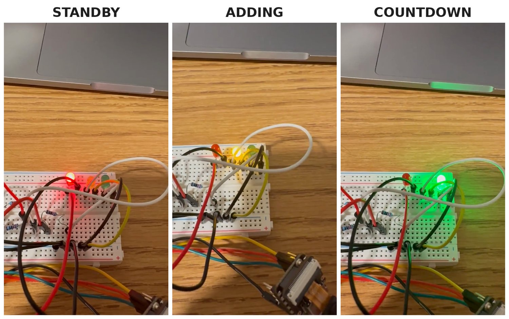
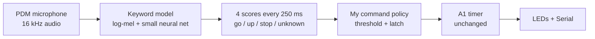
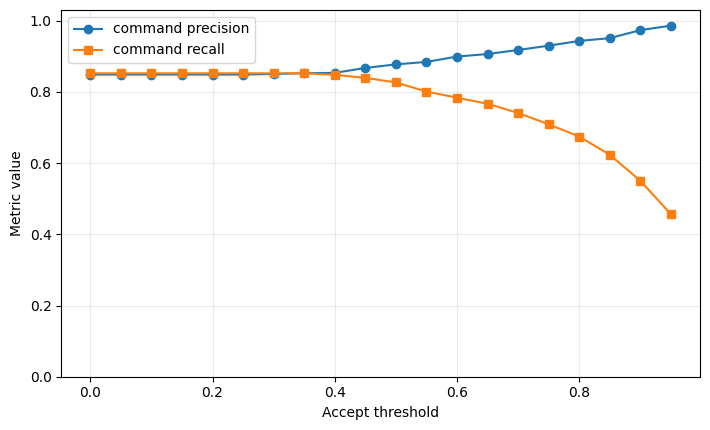
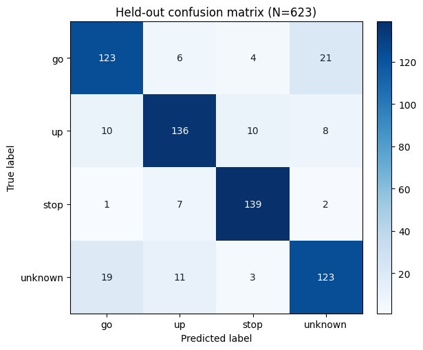
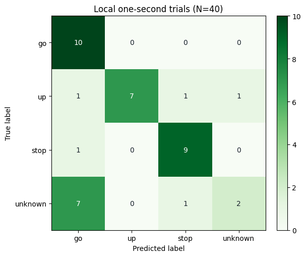

# Voice Commands with On-Device Keyword Spotting

The [A1 timer](../a1-light-timer/), now controlled by voice. Say **"up"** to add 10 s, **"go"** to start the countdown, and **"stop"** to clear it. A small speech model runs on the ESP32-S3 itself, with no cloud or phone involved, and a C++ decision policy I wrote turns its noisy output into one clean command per spoken word.

▶️ **[Watch the demo (58 s, with sound)](media/voice-timer-demo.mp4)**: up, up, go, an ignored sentence, stop, and rearming between repeated commands.

## How it works

Every 250 ms, the board feeds the last 1 s of audio to the model, which outputs a score for each of four classes. Because the windows overlap, one spoken word shows up in several windows in a row, sometimes with the scores shifting between classes. Without a policy, one "go" would fire several times, or fire as "go" and then "stop."

## The command policy (my C++ implementation)

An armed/latched state machine:

- **Accept:** fire only when the top class is a command (go, up or stop) with a score ≥ **0.90**, then **latch**.
- **While latched:** ignore everything, so one utterance produces at most one command.
- **Normal release:** rearm once ≥ **1000 ms** have passed *and* every command score is below **0.55**, meaning the word has ended.
- **Fail-safe:** if the scores stay stuck high, rearm anyway after **1500 ms** so the timer can't lock up permanently.
- The window that rearms never fires, so a stuck score can't immediately produce a duplicate.

**Choosing the 0.90 threshold.** Since a false command can start or clear the timer unprompted, I required ≥ 97% precision on accepted commands, then picked the *lowest* threshold that meets it, to keep as many real commands as possible:

| Threshold | Precision | Recall | False accepts |
|---|---|---|---|
| 0.85 | 0.951 (fails 97%) | 0.623 | 15 |
| **0.90 (chosen)** | **0.973** | **0.550** | **7** |
| 0.95 | 0.986 | 0.456 | 3 |

The trade-off: about 45% of real commands fall below the threshold and have to be repeated.

**Verification:** all 11 public policy checks pass, all 7 provided replay traces produce the expected events, and I wrote two of my own test traces (normal release, and the max-latch timeout) that pass as well.

## Results

**Provided benchmark:** 623 held-out one-second clips from 236 speakers the model never trained on. Argmax accuracy is **83.6%**.

**My own recordings:** 40 trials (10 per class), one speaker, one session, about 20 cm from the board. Accuracy was **70% (28/40)**. Commands did well (go 10/10, stop 9/10), but **7 of my 10 "unknown" words were heard as "go."** The benchmark's unknown words came from the training vocabulary, while mine (hello, table, banana, …) did not.

| Benchmark (N = 623) | My trials (N = 40) |
|---|---|
|  |  |

**Full system, counted trials (room with background noise):**

| Spoken | Attempts | Correct | Wrong | False events |
|---|---|---|---|---|
| up | 5 | 5 | 0 | – |
| go | 5 | 5 | 0 | – |
| stop | 5 | 4 | 1 (heard as go) | – |
| Non-command words | 10 | 4 ignored | – | 6 |

In a quiet room, all 15 commands worked, with scores of 0.93–1.0, but all 10 non-command words still triggered at least one event.

**Timing:** feature extraction takes about 293 ms and the classifier about 5 ms per window. Measured from the start of the spoken command to the LED change, frame by frame in 30 fps video, the latency was **0.8–1.2 s**.

## Limitations and next steps

- **False accepts on non-command words** are the main weakness, even in quiet rooms. The model's "unknown" class doesn't generalize beyond its training words.
- **Background noise** kept "go" scores around 0.55–0.80 between commands and caused extra false events.
- All testing used one speaker at about 20 cm. The next step is testing other speakers, to tell whether the false accepts are specific to my voice or the unknown class needs more training data.

## Hardware and tools

- Seeed XIAO ESP32-S3 Sense with its onboard PDM microphone
- LEDs: red on D1 (STANDBY), yellow on D2 (ADDING), green on D3 (COUNTDOWN), each through 220 Ω to GND
- C++ (Arduino framework), esp32 core 3.3.10 with OPI PSRAM; Python in Google Colab for evaluation

Raw Serial output from the 40 trials is in [`local-trials-log.txt`](local-trials-log.txt).

## Notes

Built for ECE 116 at UC San Diego. The keyword-spotting model (trained on TensorFlow's Speech Commands dataset), audio capture code, and evaluation framework were provided by the course. The command policy, threshold selection, test traces, hardware build, data collection, and system testing are my work. Source code is available on request.
